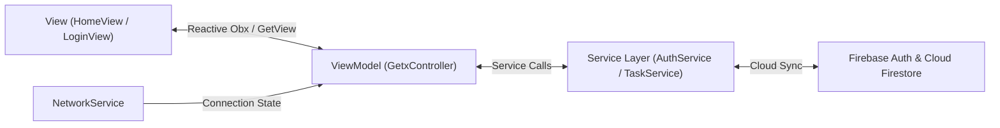

# 📋 Scheduler.io — Gig-Worker Task Management App

[](https://flutter.dev)
[](https://dart.dev)
[](https://firebase.google.com/)
[](https://pub.dev/packages/get)
[](#)

A modern, production-grade cross-platform task scheduling and productivity application built specifically for gig-workers, freelancers, and independent contractors. Built from scratch with **Flutter**, **Firebase Auth**, **Cloud Firestore**, and **GetX** following strict **Feature-First + MVVM (Model-View-ViewModel)** architecture.

---

## 🚀 Download Pre-Compiled App

> [!TIP]
> **Ready to test on your Android device?**  
> The compiled APK is ready to download directly from the **[GitHub Releases](https://github.com/your-username/task_scheduler/releases)** tab. Download the `.apk` file, install it on your device, and start scheduling right away!

---

## 📱 Screenshots & Visual Highlights

- **Branded Startup Flash Screen:** Smooth launch sequence with live Firestore connection handshake.
- **Interactive Flashcard Onboarding:** Clean introductory walkthrough for first-time users.
- **Thick Purple Header:** Spacious header displaying dynamic greeting, calendar date, active task counters, and true-pill search.
- **Chronological Sectioning:** Automatic grouping into *Overdue*, *Today*, *Tomorrow*, *This week*, and *Upcoming*.
- **Swipe-to-Delete with Undo:** Instant cloud removal with a safety snackbar for restoring tasks.
- **Calendar View:** Dedicated monthly schedule view to inspect tasks by specific dates.

---

## ✨ Features & Capabilities

### 🔐 Authentication & Session Persistence
- **Email & Password Authentication:** Complete sign-up, sign-in, and session persistence via Firebase Auth.
- **Google Sign-In:** One-tap sign-in with native credential exchange.
- **Sanitized Error Handling:** Intelligent error mapper ensures no technical jargon, internal codes, JSON snippets, or stack traces leak to the UI.
- **Full-Screen Blurred Overlay:** Smooth, frosted backdrop loader prevents button shrinking or UI glitches during authentication.

### 📝 Task Management (CRUD)
- **Create Tasks:** Modal bottom sheet with title, description, smart date pickers, quick-select chips (*Today*, *Tomorrow*, *In 2 days*, *Next week*), and priority selector.
- **Real-Time Cloud Firestore Sync:** All user tasks live under `users/{userId}/tasks/{taskId}` with zero local database baggage.
- **Immediate Reflection:** Optimistic UI state updates ensure newly created tasks reflect on screen instantly.
- **Immediate Cloud Deletion:** Swipe-to-delete immediately removes the document from Firestore (preventing resurrecting tasks on restart), backed by an **Undo** action.
- **Optimistic Checkbox Toggle:** One-tap completion toggle with muted strikethrough styling and automatic cloud sync.

### 🔍 Search, Filter & Calendar
- **True Pill Search Bar:** Live real-time search across task titles and descriptions.
- **Priority Filtering:** Filter by **High**, **Medium**, or **Low** priority via a bottom sheet.
- **Completion Filter & Batch Clear:** Toggle visibility of completed tasks or batch-clear completed tasks in an atomic Firestore batch.
- **Calendar Schedule Mode:** Switch to calendar tab to view tasks for any selected day.

### 🌐 Offline Awareness & Auto-Reconnection
- **Network Connectivity Service:** Powered by `connectivity_plus`, continuously monitoring device network state.
- **Warning Banner:** Prominent top banner alerts users when offline: *"No internet connection. Waiting for network to sync..."* with an instant Retry button.
- **Auto-Reconnection:** As soon as connectivity is restored, the app re-enables the Firestore network, triggers task re-fetch, and displays a *"Back online! Connected to Cloud Firestore."* notification.

---

## 🏗️ Architecture & Project Structure

The project strictly adheres to **Feature-First + MVVM (Model-View-ViewModel)** separation of concerns. View layers contain zero Firebase or backend calls, and ViewModels manage only UI state and business logic by delegating to dedicated service classes.

```
lib/
├── main.dart                               # App entry point, dependency injection & theme setup
├── firebase_options.dart                   # Platform-specific Firebase configuration
│
├── core/                                   # Shared core infrastructure
│   ├── constants/
│   │   └── app_strings.dart                # Centralized string constants
│   ├── services/
│   │   └── network_service.dart            # Connectivity monitoring & network state service
│   └── theme/
│       └── app_theme.dart                  # Indigo-purple design tokens, typography & inputs
│
└── features/                               # Feature-First modules
    ├── splash/
    │   └── views/
    │       └── splash_view.dart            # Branded launch screen with Firestore connection indicator
    │
    ├── flashcard/
    │   └── views/
    │       └── onboarding_view.dart        # First-time flashcard introduction
    │
    ├── auth/                               # Authentication feature
    │   ├── models/
    │   │   └── user_model.dart             # Pure immutable user model
    │   ├── services/
    │   │   └── auth_service.dart           # Firebase Auth, Google, Apple & Facebook OAuth logic
    │   ├── viewmodels/
    │   │   └── auth_viewmodel.dart         # Reactive state, form validation & error sanitization
    │   └── views/
    │       ├── auth_wrapper.dart           # Reactive root router (Splash -> Onboarding -> Auth -> Home)
    │       ├── login_view.dart             # Login interface with pill inputs & social buttons
    │       ├── signup_view.dart            # Registration interface with validation
    │       └── widgets/
    │           ├── blurred_loading_overlay.dart  # Frosted loading overlay
    │           └── social_auth_button.dart       # Reusable social button with locked state support
    │
    └── tasks/                              # Task management feature
        ├── models/
        │   └── task_model.dart             # Task entity, Firestore converters & section computer
        ├── services/
        │   └── task_service.dart           # Pure Cloud Firestore CRUD & snapshot streaming
        ├── viewmodels/
        │   └── task_viewmodel.dart         # GetX controller for sorting, filtering, CRUD & sync
        └── views/
            ├── home_view.dart              # Main dashboard with thick purple header & task sections
            └── widgets/
                ├── add_edit_task_sheet.dart       # Bottom sheet for creating and modifying tasks
                ├── swipeable_task_card.dart       # Task card with swipe-left-to-delete action
                ├── task_calendar_view.dart        # Day-by-day calendar schedule browser
                └── task_filter_account_sheet.dart # Priority filter & user account modal sheet
```

### 🧩 Data Flow (MVVM)



---

## ⚠️ Current Limitations

The following four features have specific limitations in the current version:

1. **Apple Sign-In:**
   - **Status:** The complete client authentication logic, scopes (`email`, `name`), and `OAuthProvider('apple.com')` flow are fully implemented in `AuthService`.
   - **Reason:** Apple Sign-In requires an active paid **Apple Developer Program Account** ($99/year) to configure Service IDs, private keys, and team certificates in the Apple Developer Console. Due to the unavailability of an active Apple Developer account, Apple Sign-In cannot be fully provisioned yet.
   - **UI Indicator:** The Apple button on both Login and Sign-Up screens has a **lock badge** (`Icons.lock_rounded`) and displays a *"Coming soon"* notice upon tapping.

2. **Facebook Login:**
   - **Status:** The Facebook SDK and OAuth credential authentication logic are fully implemented via `flutter_facebook_auth`.
   - **Reason:** Meta for Developers requires app review, business verification, and approval before public Facebook login permissions are unlocked. The Facebook Developer account submission is currently pending approval.
   - **UI Indicator:** The Facebook button on both Login and Sign-Up screens has a **lock badge** (`Icons.lock_rounded`) and displays a *"Coming soon"* notice upon tapping.

3. **Forgot Password:**
   - **Status:** Not yet implemented.
   - **Reason:** The self-service password reset email dispatch via Firebase Auth (`sendPasswordResetEmail`) has not yet been hooked up to a dedicated dialog or screen.

4. **Email Verification:**
   - **Status:** Not yet implemented.
   - **Reason:** Users are currently logged in directly upon account creation without requiring a verification email click link (`sendEmailVerification`).

---

## 🔮 Future Scope & Roadmap

- [ ] **Apple Sign-In Activation:** Wire Apple Services ID, Key ID, and Team ID once Apple Developer Program enrollment is completed.
- [ ] **Facebook Login Activation:** Complete Meta Developer app review and business verification to enable Facebook sign-in for all users.
- [ ] **Forgot Password Flow:** Add a clean dialog/screen enabling users to reset passwords via automated Firebase emails.
- [ ] **Mandatory Email Verification:** Introduce an email verification banner/gate before granting full workspace access.
- [ ] **Push Notifications & Due Date Reminders:** Integrate Firebase Cloud Messaging (FCM) and `flutter_local_notifications` for upcoming and overdue task alerts.
- [ ] **Recurring Gig Tasks:** Support daily, weekly, or custom recurring intervals for routine tasks.
- [ ] **Categories & Tags:** Custom user-defined tags (e.g., *Uber*, *DoorDash*, *Freelance*, *Personal*).
- [ ] **Export & Reports:** Export scheduled tasks and completed history to PDF or CSV for tax and gig-earnings records.

---

## 🛠️ Tech Stack & Dependencies

| Category | Technology |
|---|---|
| **Framework** | Flutter (Dart SDK `^3.10.7`) |
| **State Management & DI** | GetX (`^4.7.3`) |
| **Authentication** | Firebase Auth (`^7.0.1`), Google Sign-In (`6.2.2`), Flutter Facebook Auth (`^7.3.3`) |
| **Database** | Cloud Firestore (`^7.1.0`) |
| **Connectivity** | Connectivity Plus (`^7.3.2`) |
| **Date & Formatting** | Intl (`^0.20.3`) |
| **Environment Configuration** | Flutter DotEnv (`^6.0.2`) |

---

## 💻 Local Setup & Development

### Prerequisites
- [Flutter SDK](https://docs.flutter.dev/get-started/install) installed (version 3.10.7 or higher).
- Android Studio / Xcode (for simulators/emulators).
- A Firebase project configured with Authentication (Email/Password & Google) and Cloud Firestore.

### Installation

1. **Clone the repository:**
   ```bash
   git clone https://github.com/your-username/task_scheduler.git
   cd task_scheduler
   ```

2. **Install dependencies:**
   ```bash
   flutter pub get
   ```

3. **Configure Firebase:**
   - Place your `google-services.json` in `android/app/`.
   - Place your `GoogleService-Info.plist` in `ios/Runner/`.
   - Ensure `lib/firebase_options.dart` matches your Firebase project credentials.

4. **Environment Variables (Optional):**
   - Copy `.env.example` to `.env` if environment variables are needed:
     ```bash
     cp .env.example .env
     ```

5. **Run the application:**
   ```bash
   # Run on connected device or emulator
   flutter run
   ```

6. **Run Analyzer & Unit Tests:**
   ```bash
   flutter analyze
   flutter test
   ```

---

## 📄 License

This project is licensed under the [MIT License](LICENSE).
